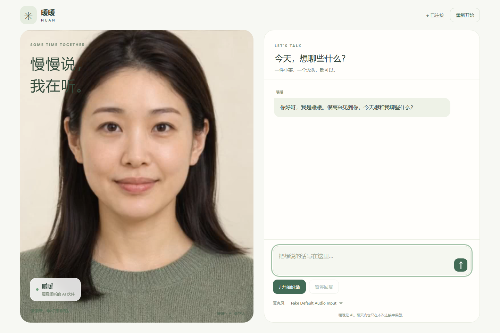
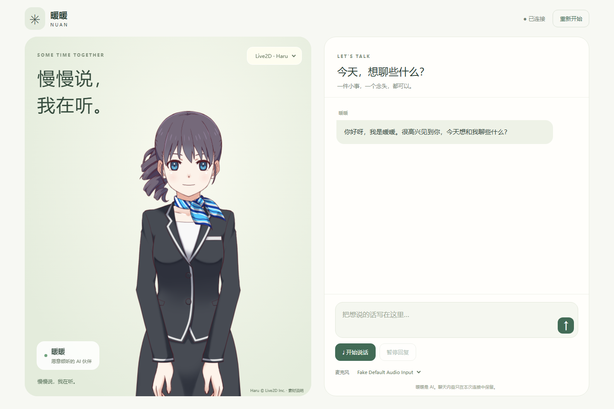

# 暖暖 · 独立数字人聊天页

打开就是数字人与聊天窗口。可以打字、使用麦克风、暂停回复或重新开始。
支持自然真人连续画面与 Live2D（Haru）两种形象，使用普通自由聊天。





项目只有独立网页和一个很小的模型接口适配层。没有登录、账号管理、任务、问卷、报告、来源标签、六维访谈或多阶段审阅。聊天历史只保留在当前 WebSocket 连接内，不写数据库。

## 启动

Python 3.12：

```bash
python -m venv .venv
# macOS / Linux
source .venv/bin/activate
# Windows PowerShell 使用：.venv\Scripts\Activate.ps1
pip install -r requirements.txt
cp .env.example .env
# Windows 可使用：Copy-Item .env.example .env
python -m uvicorn server:app --env-file .env --host 127.0.0.1 --port 8080 --ws-max-size 4194304
```

打开 **http://localhost:8080**。首次说话需要允许浏览器使用麦克风。远程访问需要 HTTPS；本机 `localhost` 可以使用麦克风。

人物区域右上角可切换“自然真人 / Live2D · Haru”，也可直接打开 **http://localhost:8080/?avatar=live2d**。
切换会停止当前回复和录音，保留当前连接里的聊天记录与已完成对话上下文，声音参数不变。
Live2D 的模型、贴图和固定版本运行库已随项目提供，不需要构建前端或运行时访问 CDN。

本项目不包含大模型权重或 GPU 推理服务。先在 `.env` 中填写自己的服务地址；地址和密钥只由 Python 读取，不放进网页或 Git 仓库。Live2D 在浏览器运行，只需接入对话、TTS、ASR 服务即可完成语音聊天；**不依赖自然真人推理服务**。没有模型服务时可以看到 Live2D 待机动作，但无法生成聊天回复。

| 环境变量 | 接口 |
|---|---|
| `LLM_URL`、`LLM_MODEL` | OpenAI 兼容的 `POST /v1/chat/completions`，SSE 文本输出 |
| `TTS_URL` | `POST /v1/audio/speech`，24 kHz、单声道、16 位 PCM 连续输出；兼容现有 Nuan Qwen3-TTS 适配接口 |
| `ASR_URL` | `POST /transcribe`，JSON `{audio: base64 WAV, language: "Chinese"}` → `{text}` |
| `CONTINUOUS_AVATAR_URL` | 现有自然真人服务的 `/actor` WebSocket，fMP4 + 说话时间点 |
| `NATURAL_AVATAR_URL`、`PORTRAIT_ID` | `GET /portraits/{id}` 获取对应人物照片 |
| `LLM_API_KEY` | 可选；仅在服务器连接自己的对话服务时使用 |

现有模型服务可直接复用，无需运行原管理平台。服务地址默认是本机回环地址，未写入任何实际服务器地址、SSH 账号或登录凭据。

## 对话流程

```text
文字输入 ──────────────┐
麦克风 → WAV → ASR ────┤
                      ↓
              最近聊天上下文 + 一次 LLM 生成
                      ↓
               一次连续 TTS 生成
                      ↓
        ┌─────────────┴─────────────┐
        ↓                           ↓
  自然真人连续音视频流        Live2D：PCM 音频流
        ↓                           ↓
    视频媒体时间轴          浏览器播放 + 本地人物渲染
        └─────────────┬─────────────┘
                      ↓
                文字随语音出现
```

`chat.py` 中只有一个普通对话 system prompt。没有问卷结果、标签分类、固定探问计划、语义复核或改写调用。用户决定聊什么。语音固定为 Serena，基准语速 1.0，不随会话切换。

麦克风默认选择系统默认设备。点击“开始说话”录音，再点“发送这段语音”；最长30秒自动提交。切到后台或离开页面会停止录音。回复播放完成以人物流的 `cue_end` 为准，服务器生成完成不会提前结束声音。

Live2D 具有轻微呼吸、眨眼和头部动作，嘴部开合跟随实际播放音频的能量，并平滑收嘴。这里未接入逐音素强制对齐服务。PCM 播放器按设备采样率重采样（支持24/44.1/48 kHz），初始缓冲240毫秒；整轮只做一次连续合成，不按句子重新换声。生成结束后会继续播放队列中的声音，全部播放完成才恢复输入。

## 文件

```text
web/
  index.html, style.css, app.js   独立聊天页面
  natural-companion.js           人物状态与说话时间点
  natural-media.js               连续 fMP4 播放
  live2d-avatar.js               Live2D 渲染、呼吸、眨眼、嘴部动作
  pcm-speech.js, pcm-worklet.js   流式 PCM 播放与设备采样率适配
  assets/live2d/, vendor/live2d/  Haru 模型与浏览器运行库、许可文件
  microphone.js, mic-*.js        麦克风与 WAV 编码
  assets/portrait.jpg            离线时的静态人物占位
server.py                       页面与 WebSocket 接口
chat.py                         自由对话 prompt 和固定声音参数
actor.py                        人物服务适配
speech.py                       两种形象共用的 TTS 流与 PCM 校验
tests/                          不依赖 GPU 的自动测试
```

想接自己的后端时，可直接使用 `web/`，实现 [接口约定](API.md) 即可；前端不依赖 React、Vue 或打包工具。

## 验证

```bash
python -m unittest discover -s tests -p "test_*.py" -v
npm test
```

上述测试使用合成文本、音频和模拟服务。Live2D 浏览器验证使用真实 Cubism/WebGL 渲染和合成 PCM，覆盖说话收嘴、切换形象、打断、录音取消与手机布局。实际回复质量、首声时间取决于接入的模型服务与网络。自然真人推理模型不在本仓库，必须配置后才能使用自然真人。

## 素材

页面和播放器从现有 Nuan 项目独立整理，人物照片沿用该项目的演示素材。仓库公开不代表对照片的再次分发作额外授权。

Live2D 角色为 [Haru（官方接待员示例）](https://www.live2d.com/en/learn/sample/haru-receptionist/)。本内容使用 Live2D Inc. 拥有版权的示例素材，遵循其使用条件。本项目内容由作者独立制作。本仓库保留模型、贴图及运行数据，不包含示例自带的音频、PSD 或编辑器项目。

角色适用 [示例素材使用条件](https://www.live2d.com/en/learn/sample/model-terms/) 与 Free Material License；Cubism Core / Framework 适用各自许可，PixiJS 与 pixi-live2d-display 自有代码的 MIT 许可一并保留。完整说明在 `web/live2d-notice.html`，来源与校验值在 `web/vendor/live2d/sources.json`。这些素材和运行库不因本仓库公开而改变原有使用条件。推理模型权重仍不包含在仓库内。
